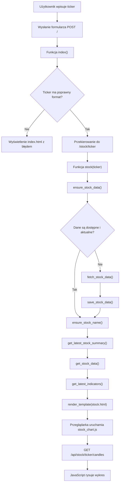
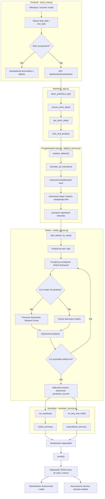
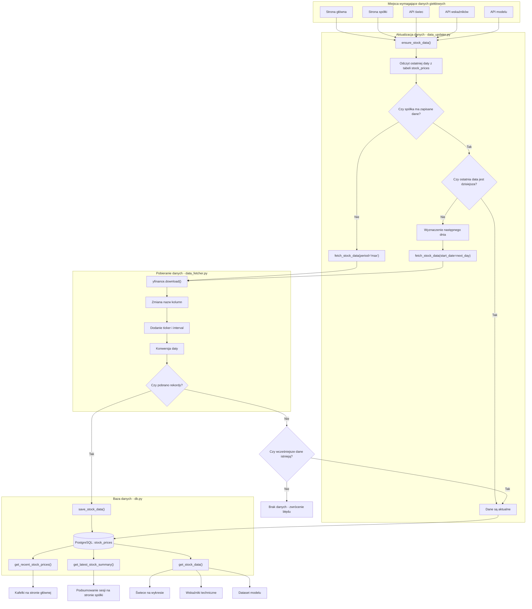

# Architektura projektu

## Cel dokumentu

Dokument opisuje budowę aplikacji, odpowiedzialność jej głównych elementów
oraz przepływ danych pomiędzy frontendem, backendem, bazą danych,
modelem predykcyjnym i symulatorem transakcji.

## Główne elementy systemu

Aplikacja jest podzielona na kilka warstw. Każda warstwa odpowiada za inny
rodzaj operacji i komunikuje się tylko z wybranymi częściami systemu.

| Element | Lokalizacja | Odpowiedzialność                                                                    |
|---|---|-------------------------------------------------------------------------------------|
| Frontend | `templates/`, `static/` | Wyświetla strony, wykresy i wyniki oraz wysyła zapytania do API.                    |
| Aplikacja Flask | `app.py` | Odbiera zapytania użytkownika, wywołuje odpowiednie serwisy, zwraca HTML albo JSON. |
| Pobieranie danych | `services/data_fetcher.py` | Pobiera dane giełdowe i informacje o spółkach.                                      |
| Aktualizacja danych | `services/data_updater.py` | Sprawdza dostępność danych i zapisuje brakujące rekordy.                            |
| Baza danych | `services/db.py` | Odpowiada za połączenie z bazą, odczytywanie i zapisywanie danych.                  |
| Wskaźniki techniczne | `services/technical_indicator_service.py` | Oblicza wskaźniki giełdowe.                                                         |
| Zmiana interwału | `services/resample_service.py` | Łączy dane dzienne w większe świece, na przykład tygodniowe.                        |
| Przygotowanie datasetu | `services/ml/dataset_service.py` | Przygotowuje cechy i target wykorzystywane do trenowania modelu.                    |
| Model predykcyjny | `services/ml/model_service.py` | Trenuje model, wykonuje walk-forward i przygotowuje predykcje oraz metryki.         |
| Symulator transakcji | `services/simulator_service.py` | Symuluje grę na giełdzie korzystając z predykcji modelu oraz innych strategii.      |
| Informacje o spółkach | `services/company_service.py` | Pobiera i zapisuje nazwy spółek.                                                    |
| Testowanie modelu | `evaluate_model.py` | Testy modelu i symulatora dla wielu spółek.

## Przepływ otwierania strony spółki

Poniższy diagram pokazuje przepływ od wpisania tickera na stronie głównej
do wyświetlenia strony spółki i narysowania wykresu.

## Przepływ uruchomienia modelu i symulatora

Proces rozpoczyna się po kliknięciu przycisku „Uruchom model”.
Frontend wysyła zakres dat do API, backend przygotowuje dataset,
wykonuje walk-forward, uruchamia dwie strategie i zwraca wyniki do strony.

## Przepływ danych giełdowych

Aplikacja nie pobiera całej historii z yfinance przy każdym zapytaniu.
Najpierw sprawdza dane zapisane w PostgreSQL, a następnie pobiera tylko
brakującą historię.

## Endpointy aplikacji

Poniższa tabela przedstawia trasy udostępniane przez aplikację Flask.
Trasy zwracają gotową stronę HTML, przekierowanie albo dane JSON.

| Metoda | Endpoint | Funkcja | Parametry | Wynik                                                              |
|---|---|---|---|--------------------------------------------------------------------|
| `GET` | `/` | `index()` | Opcjonalny parametr `error` | Strona główna z wyszukiwarką                                       |
| `POST` | `/` | `index()` | Pole formularza `ticker` | Przekierowanie na stronę wybranej spółki albo komunikat o błędzie. |
| `GET` | `/stock/<ticker>` | `stock()` | Ticker umieszczony w adresie | Strona spółki z podsumowaniem i wskaźnikami.                       |
| `GET` | `/api/stock/<ticker>/candles` | `stock_candles_api()` | Opcjonalny `interval`, domyślnie `1d` | JSON zawierający świece dla wykresu.                               |
| `GET` | `/api/stock/<ticker>/indicators` | `stock_indicators_api()` | Opcjonalny `interval`, domyślnie `1d` | JSON zawierający serie wskaźników technicznych.                    |
| `GET` | `/api/stock/<ticker>/prediction` | `stock_prediction_api()` | Wymagane `start_date` i `end_date` | JSON zawierający predykcje, metryki modelu i wyniki symulatora.    |

